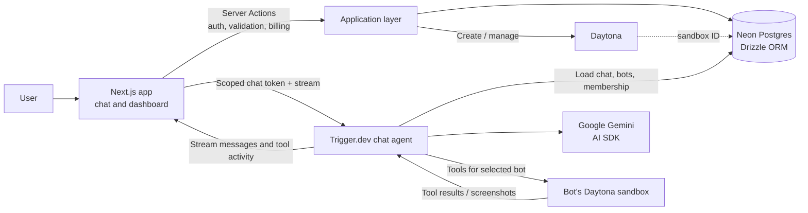
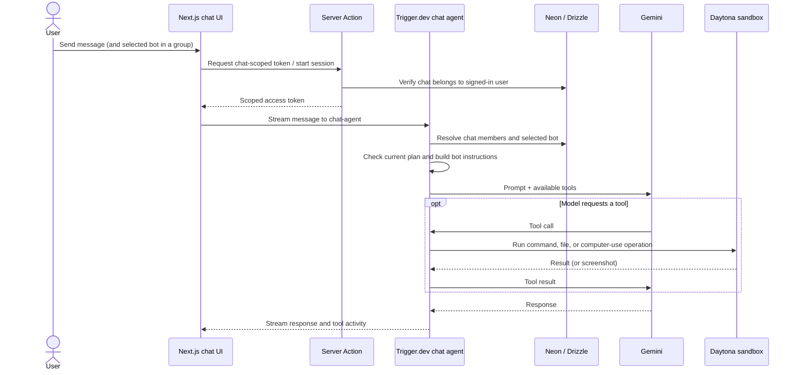
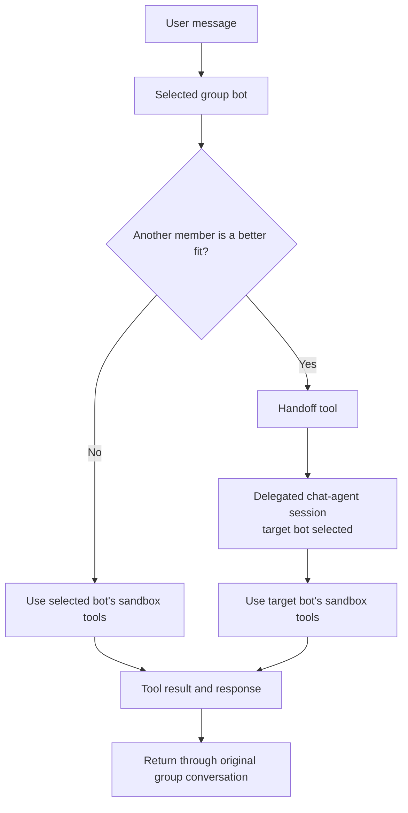
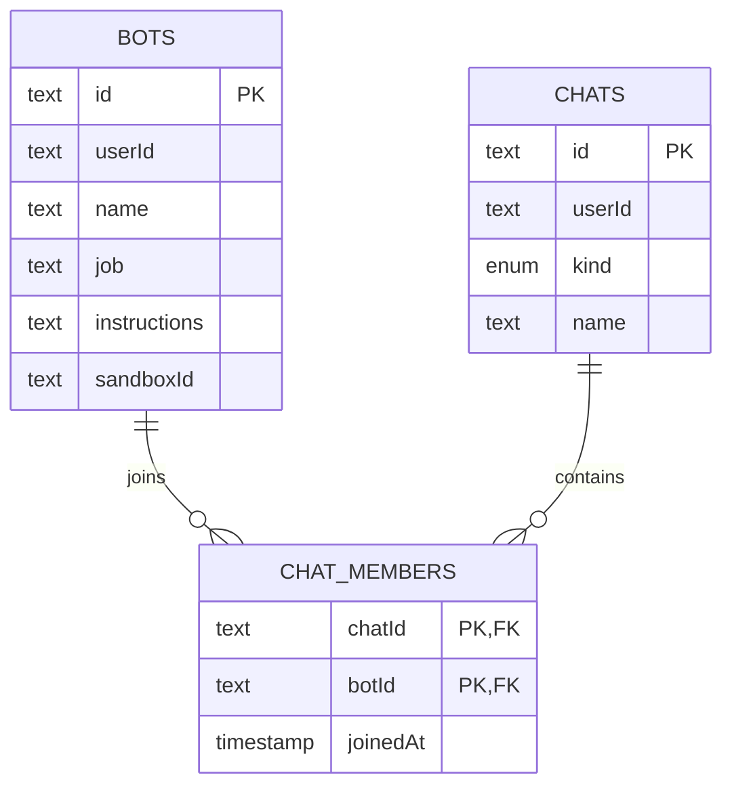

# AI Agency

AI Agency is a web workspace for creating role-specific AI bots and using them in private or multi-bot group chats. Each bot can use its own Daytona sandbox for file, command, and browser/computer interaction; group members can delegate requests to one another.

## Architecture at a glance



The application separates the interactive web experience from agent execution. Next.js handles authenticated pages, user-facing mutations, and chat UI; Trigger.dev runs the chat agent and streams its response; Daytona supplies the bot's remote execution environment. Neon is the durable store for bot and chat metadata, while Trigger.dev chat storage holds conversation transcripts.

## Why the system is split this way

An AI model is not a computer, a durable database, or an indefinitely running process. This application uses distinct components to supply those capabilities rather than treating the model itself as the whole system:

- **Long-running and streaming work:** the chat agent runs through Trigger.dev instead of tying the full model/tool loop to a normal page request. The Trigger.dev configuration allows up to an hour per task and configures retries.
- **A real, isolated workspace:** each bot is assigned a Daytona sandbox. The agent's shell, file, and computer-use tools act on that remote sandbox—not on the user's browser machine or the Next.js server's filesystem. Sandboxes can be started on demand and referenced by ID from the bot record.
- **Durable identity and state:** Neon stores bot definitions, chat records, and chat membership. A bot's small persistent memory is a file (`workspace/.bot-memory.md`) in its sandbox, shared when that bot participates in private and group chats. Transcripts are loaded and saved using Trigger.dev chat storage.
- **Bounded tool access:** sandbox tools validate inputs and constrain file paths to the workspace; file sizes, command duration/output, and listed file counts are capped. This makes the tools a defined interface to the sandbox rather than unrestricted access to the host application.
- **Explicit ownership and entitlements:** Clerk identity is checked in server-side actions and queries. Bot and sandbox usage is gated by the `pro` plan, and chat access tokens are scoped to a single chat session.
- **Recoverable provisioning:** bot creation provisions a sandbox and then writes the bot, direct chat, and membership records. If the database write fails, the action attempts to delete the newly created sandbox so the external resource is not orphaned.

## Chat request flow



The browser component in `components/chat.tsx` loads the transcript, obtains the chat transport from Trigger.dev, and renders messages and tool activity. The `chat-agent` in `trigger/chat.ts` resolves the bot from the chat and membership tables, checks the plan again at turn start, chooses the Google Gemini model, and supplies sandbox tools from `trigger/sandbox-tools.ts`.

## Group chats and delegation

A group chat is a `chats` row with `kind = "group"` plus one `chatMembers` row per participating bot. The user selects which bot receives a message; that bot may hand off work to another member when appropriate.



Handoffs are represented with a `handoff:<parent-chat-id>:<unique-id>` session ID. The agent resolves the parent chat to find the group members and runs the target bot in a delegated session. Delegated turns are instructed to fulfill the request directly rather than handing it off again, preventing recursive delegation loops. Each bot still acts through its own assigned sandbox and instructions.

## Data model



`db/schema.ts` defines the PostgreSQL tables, relations, and Zod-backed input schemas. `queries/` contains authenticated read paths; `actions/` contains server-side mutations. User ownership is part of the relevant queries and updates, and chat membership connects bots to both direct and group conversations.

## Repository map

```text
app/                  Next.js App Router pages, layouts, and styling
  (auth)/              Sign-in and sign-up pages
  (dashboard)/         Authenticated workspace and chat routes
  pricing/             Clerk Billing pricing page
actions/               Authenticated server actions for bots, chats, and chat sessions
components/            Chat UI, app chrome, AI elements, and shared UI
  ai-elements/         Message, prompt, conversation, and tool presentation
  ui/                  Reusable interface primitives
db/schema.ts           Drizzle tables, relations, and shared validation schemas
drizzle/               Drizzle-generated database artifacts/configuration
lib/                   Database, Daytona, billing, and shared helpers
queries/               Authenticated reads for bots and chats
trigger/               Trigger.dev chat agent and sandbox tool implementations
```

## Technology

- **Runtime and framework:** TypeScript, Next.js 16, React 19
- **Authentication and billing:** Clerk, including Clerk Billing
- **Agent runtime and chat transport:** Trigger.dev Chat
- **Model and tools:** AI SDK with Google Gemini
- **Isolated computer environment:** Daytona SDK
- **Persistence:** Neon serverless Postgres, Drizzle ORM, and Drizzle Zod schemas
- **UI:** Tailwind CSS, shadcn components, and AI Elements

## Setup

### Prerequisites

- Node.js compatible with the project's Next.js and Trigger.dev runtime configuration
- A Neon Postgres database
- Clerk application with sign-in/sign-up enabled and Billing configured
- Trigger.dev project configured for this application
- Google AI API key for the Gemini model
- Daytona account/API credentials for sandbox operations

Install dependencies and create `.env.local` with the credentials for your services. At minimum, configure `DATABASE_URL`, Clerk's Next.js keys (`NEXT_PUBLIC_CLERK_PUBLISHABLE_KEY` and `CLERK_SECRET_KEY`), the Google AI SDK key (`GOOGLE_GENERATIVE_AI_API_KEY`), Trigger.dev credentials, and `DAYTONA_API_KEY`. The Daytona API endpoint can be overridden with `DAYTONA_API_URL` or `DAYTONA_SERVER_URL`; it otherwise defaults to `https://app.daytona.io/api`. Keep secrets server-side and out of version control.

Configure Clerk Billing with a publicly visible User Plan whose slug is exactly `pro`; the pricing UI is set up for USD $10/month. Enable Billing on the Clerk application. Trigger.dev must also have `CLERK_SECRET_KEY` configured so the agent can verify the user's active plan on each turn.

### Run locally

```bash
npm install
npm run db:push
npm run dev
```

Run the Trigger.dev development process in a second terminal so chat tasks are available:

```bash
npx trigger.dev@latest dev
```

The web app is served by Next.js. The Trigger.dev CLI runs the configured tasks from `trigger/` during local development. `npm run db:push` applies the Drizzle schema to the configured database.

### Useful commands

```bash
npm run build       # Production build
npm run start       # Serve the production build
npm run lint        # ESLint
npm run typecheck   # TypeScript checks
npm run db:studio   # Open Drizzle Studio
```

## Billing behavior

Creating and using bots and sandboxes requires an active Clerk User Plan with slug `pro`. The pricing page uses Clerk's `PricingTable`; configure the plan in Clerk as USD $10/month. Bot creation, chat turns, and sandbox access check the plan server-side, in addition to the client-side upgrade messaging.
